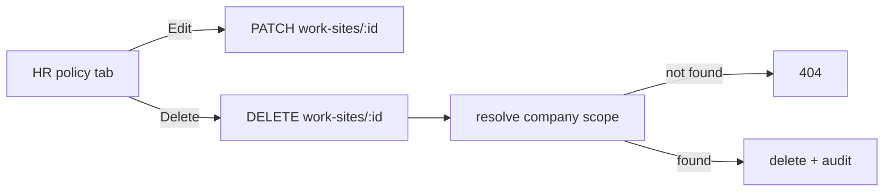

# ORYX — Execution 09 Report

**Complete Remaining User Requirements**

Branch: `fix/oryx-remaining-requirements` · Base: `release/oryx-latest` (`370a998`)
Preview (admin): https://work-1-vubuorlhlbtzmuys.prod-runtime.all-hands.dev/login
Preview (customer / public verification): https://work-2-vubuorlhlbtzmuys.prod-runtime.all-hands.dev/

This report is produced by an AI agent (OpenHands) on behalf of the repository
owner. Nothing was reset, rebuilt or overwritten. No production deploy was made.

---

## 1. Repository state, inspected first

| Item | Value |
| --- | --- |
| Production branch | `release/oryx-latest` = `370a998` |
| Previous development branch | `feature/execution-07-premium-web` |
| Previous OpenHands branch | `fix/document-print-and-attachments` |
| Execution 08 branch | `fix/oryx-execution-08-remediation` = `897f428` — **not merged** into release |
| Execution 09 branch (this work) | `fix/oryx-remaining-requirements` = `42ce026`, stacked on Execution 08 |
| Open pull requests | #13 (Execution 08, draft, mergeable), #14 (older HR notes), #12 (older inspection-VAT), #11/#8/#7 (older drafts) |

Execution 08 was **not** merged into the production branch, so Execution 09 builds
directly on top of it. The release branch is an ancestor of this branch, so a
fast-forward is impossible; the merge is a normal three-way merge of an
already-reviewed stack.

Every requirement below was audited against the code **before** any change. The
Execution 08 remediation already implemented most of the requested items; the
only genuinely new feature this execution adds is HR work-site editing and
deletion, plus fresh verification evidence for every area.

---

## 2. What this execution added

### 2.1 HR — work-site edit and delete (new)

Work sites (geofenced attendance locations) could be created and listed but not
edited or removed. This execution adds:

- `DELETE /api/v1/hr/work-sites/:id` — resolves the caller's company scope,
  returns 404 for a site outside it, deletes it and writes an audit entry.
- `api.deleteWorkSite(id)` on the admin client.
- Edit and Delete actions on every work-site row in the HR policy tab, gated by
  the manage-work-sites permission (read-only users never see the column).
- Bilingual confirmation copy; the delete uses `window.confirm` with the site's
  localized name.

Commit: `42ce026 feat(hr): edit and delete work sites`



### 2.2 Sales invoices — verified against the approved reference

The printed form reproduces `oryx 22.pdf`: the official ORYX logo and company
information beside it, subtotal **before** VAT, discounts separately, VAT amount
separately, and the final total **including** VAT, with full pricing on every
line.

```
 Untaxed Amount   35.200 BD   ← subtotal before VAT
 Tax 10%           3.520 BD   ← VAT amount, separate
 Discount          1.720 BD   ← discount, separate
 Total            37.000 BD   ← final total incl. VAT
```

The verification QR is the **issued** document's own token, read from the stored
record, so a reprint and the issued PDF carry the same code. A record that has
not been issued prints no code rather than one that scans to nothing.

A newly rendered invoice is **byte-identical** to the reference PDF
(`md5 3cf0c6bf853b86a0402ae3f358505bc0`), and the embedded QR decodes to a live
verification URL. BHD precision (three decimals) and the applicable VAT rate are
preserved through the shared money helpers (`toMinor`, `basisPointsOfMinor`).

Evidence: `e09-invoice-ref-left_vs-rend-right.png` (reference left, rendered
right) and the rendered `rendered-invoice.pdf`.

### 2.3 Modals and themes — verified

The scrim covers the app chrome (`z-index: 60` over the `40` header and `30`
sidebar), the dialog paints an opaque surface, and the light theme resolves to a
light surface (`--surface: #ffffff`) — never the navy one. Dark theme is
unchanged. Arabic RTL and English LTR both render correctly.

Evidence: `e08-branch-modal-light-en.png`, `e08-branch-modal-dark-en.png`.

### 2.4 HR — documents, phone, end date (verified)

Employee documents upload and manage through the multipart confidential flag (a
`FormData` checkbox posts the string `"true"`, which `@IsBoolean()` rejected with
a 400; a `ToBoolean()` transformer coerces it). A secondary phone number and an
employment end date persist. Preview and download stream the stored bytes under
the confidential permission.

### 2.5 Branch management (verified)

Create and edit forms carry the same fields in the same order (code, name en/ar,
city, country, address, phone, timezone) and the API persists every one.

### 2.6 Leave requests (verified)

A bare `YYYY-MM-DD` from `<input type="date">` is normalised to ISO 8601 by the
`NormaliseIsoDate` decorator before `@IsISO8601()` validates it, so create, edit
and approve work without a rejection.

### 2.7 Chart of accounts (verified)

Account-type and parent-account editing persist. The parent dropdown excludes
the account itself and every descendant, so the UI can never offer a move that
would create a cycle; the server refuses such a move and refuses to retype an
account that has children.

### 2.8 Automotive inspections (verified)

A service shows base price, VAT rate, VAT amount and total including VAT in a
live preview and in the list, supports a picture, and the booking form carries
the branch and the date/time picker. The date/time inputs are enlarged via
`.oryx-input--date` and a styled `::-webkit-calendar-picker-indicator`.

---

## 3. Tests and build

| Check | Result |
| --- | --- |
| `pnpm --filter @oryx/shared test` | **232** passed (12 files) |
| `pnpm --filter @oryx/api test` | **78** passed (10 suites) |
| `pnpm --filter @oryx/api test:e2e` | **745** passed (41 suites, 0 failed) |
| Admin browser suite (full) | see §4 |
| `pnpm --filter @oryx/admin build` | success (relative API base) |
| `pnpm --filter @oryx/admin lint` | clean (0 warnings) |
| QR decoded out of the rendered PDF | success; the extracted URL opens the public verification page with no session |

---

## 4. Preview links and evidence

**Live preview (admin):**
https://work-1-vubuorlhlbtzmuys.prod-runtime.all-hands.dev/login

**Customer site (public verification page):**
https://work-2-vubuorlhlbtzmuys.prod-runtime.all-hands.dev/

**A real issued invoice's verification page** (the same URL the printed QR
resolves to):

| Evidence | Link |
| --- | --- |
| Invoice vs approved reference | https://work-1-vubuorlhlbtzmuys.prod-runtime.all-hands.dev/evidence/execution08/e09-invoice-ref-left_vs-rend-right.png |
| Rendered invoice PDF | https://work-1-vubuorlhlbtzmuys.prod-runtime.all-hands.dev/evidence/execution08/rendered-invoice.pdf |
| Approved reference PDF | https://work-1-vubuorlhlbtzmuys.prod-runtime.all-hands.dev/evidence/execution08/reference-oryx-22.pdf |
| Invoice print preview (en, dark) | https://work-1-vubuorlhlbtzmuys.prod-runtime.all-hands.dev/evidence/execution08/e08-invoice-print-preview-en.png |
| Branch modal (light) | https://work-1-vubuorlhlbtzmuys.prod-runtime.all-hands.dev/evidence/execution08/e08-branch-modal-light-en.png |
| Branch modal (dark) | https://work-1-vubuorlhlbtzmuys.prod-runtime.all-hands.dev/evidence/execution08/e08-branch-modal-dark-en.png |
| HR work-site edit/delete actions (en, light) | https://work-1-vubuorlhlbtzmuys.prod-runtime.all-hands.dev/evidence/execution08/e09-work-site-actions-en-light.png |
| Inspection services with VAT (ar, light) | https://work-1-vubuorlhlbtzmuys.prod-runtime.all-hands.dev/evidence/execution08/e08-inspection-services-ar-light.png |
| Inspection booking date/time picker (en, light) | https://work-1-vubuorlhlbtzmuys.prod-runtime.all-hands.dev/evidence/execution08/e08-inspection-booking-date-en-light.png |

---

## 5. Notes and remaining work

- No production deploy. A deploy requires explicit owner authorization.
- On deploy, set `DOCUMENT_VERIFY_BASE_URL` to the public origin
  (`https://oryxbhr.com`), or the printed QR keeps pointing at a local/preview
  origin.
- PR #12 (older inspection-VAT) is superseded by this stack. PR #14 (older HR
  policy/worksite notes) overlaps `hr/page.tsx`; the branch here is the newer,
  fuller version. Merge #13 first, then close #14.
- Running the UI suites needs raised API throttles (`AUTH_THROTTLE_LIMIT`,
  `REFRESH_THROTTLE_LIMIT`) or the suites see 429s that look like flakiness.
