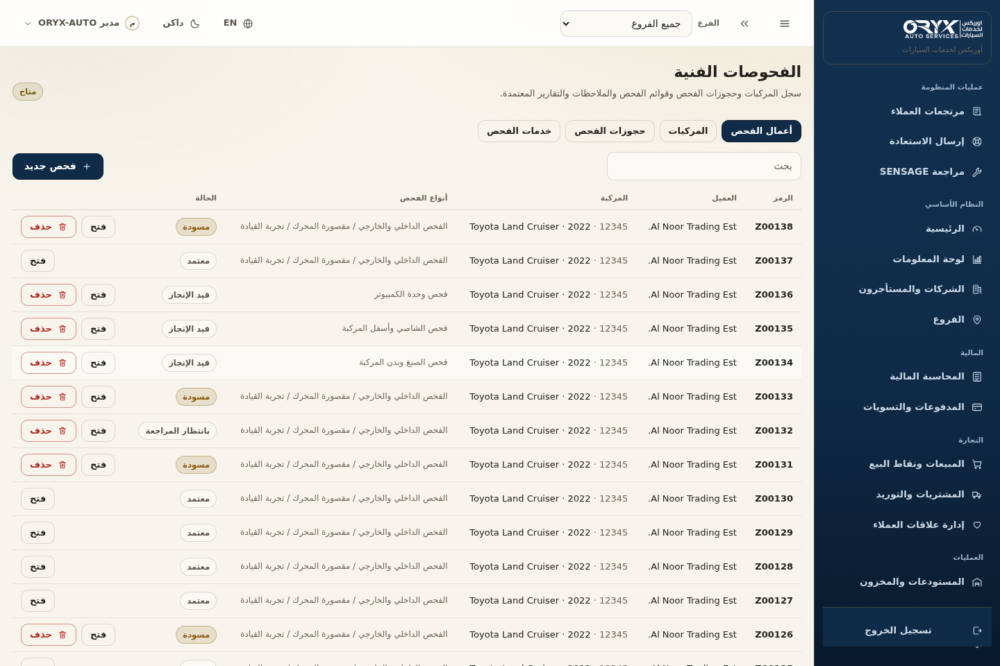
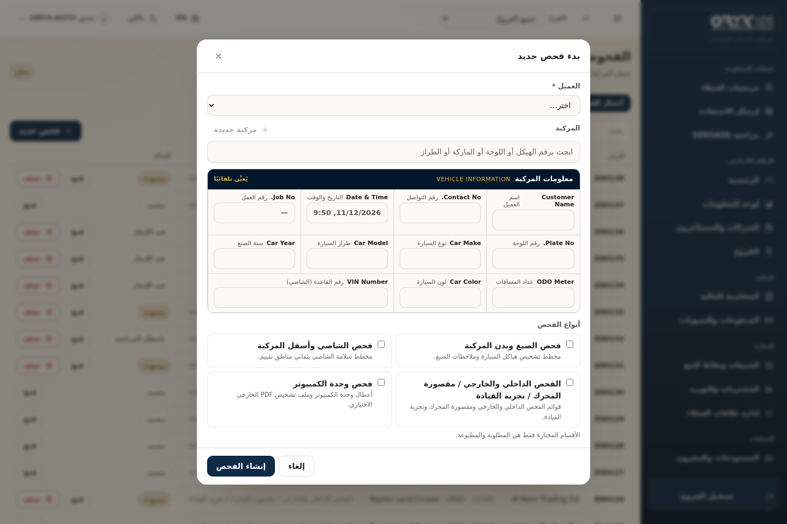
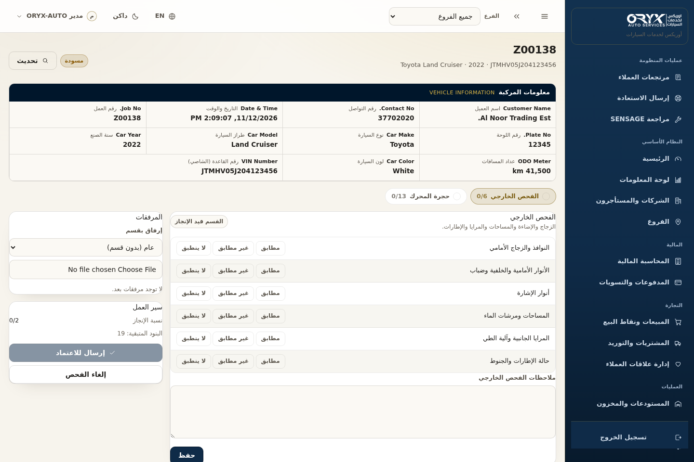
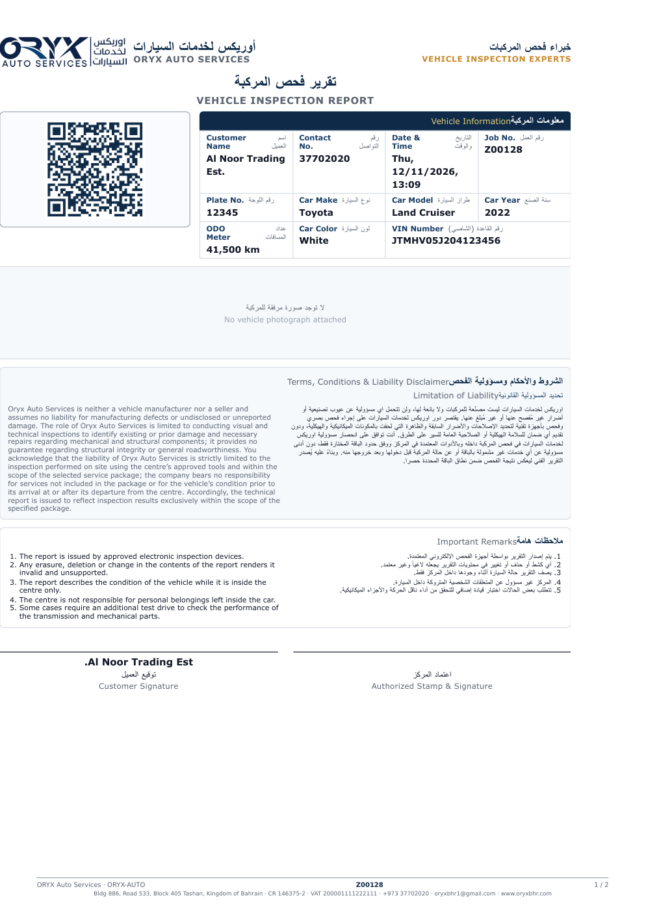
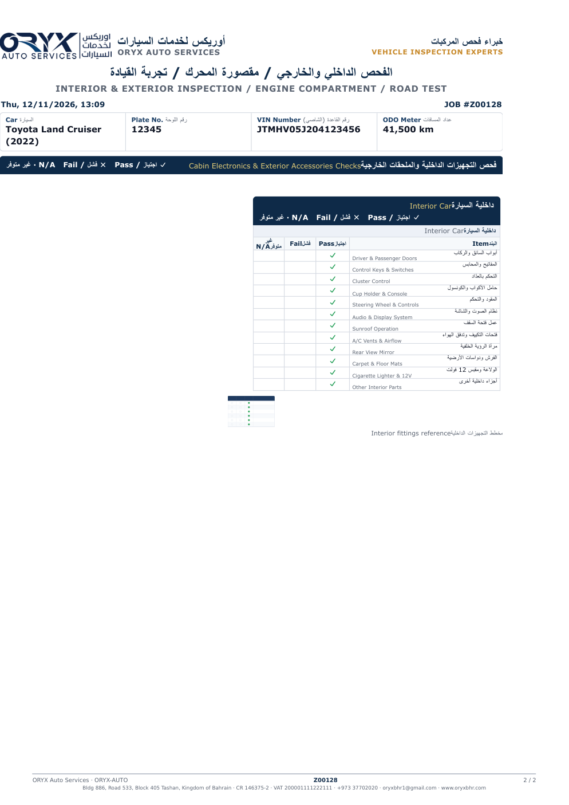
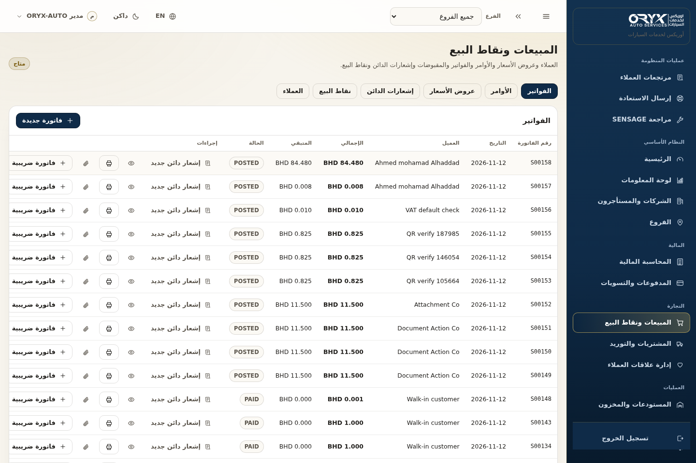
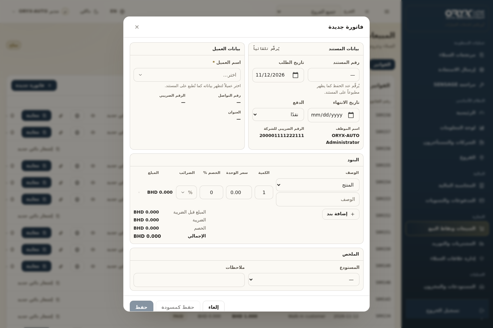
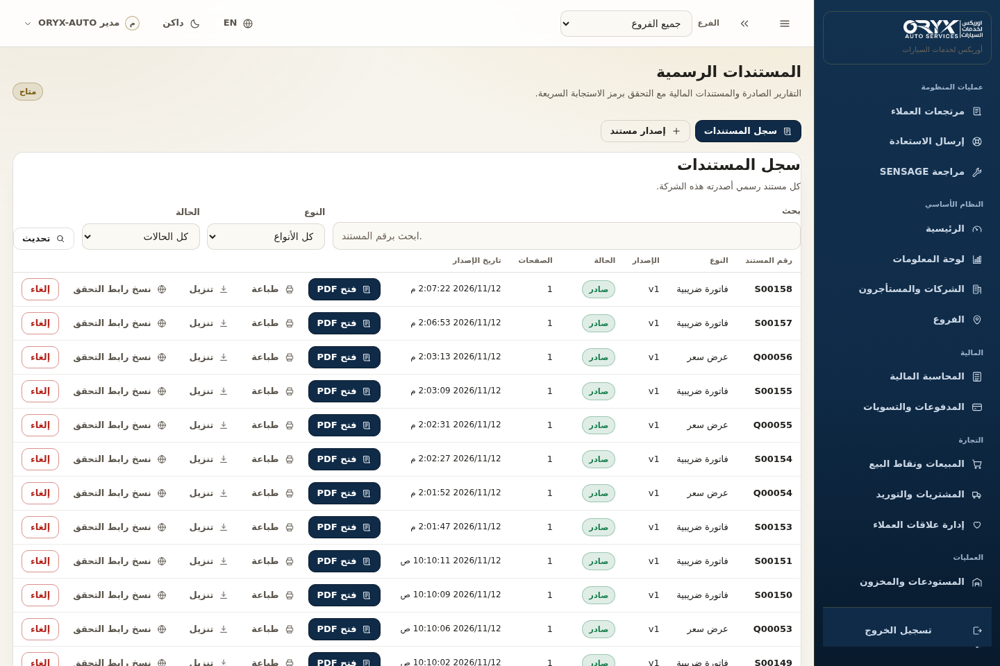
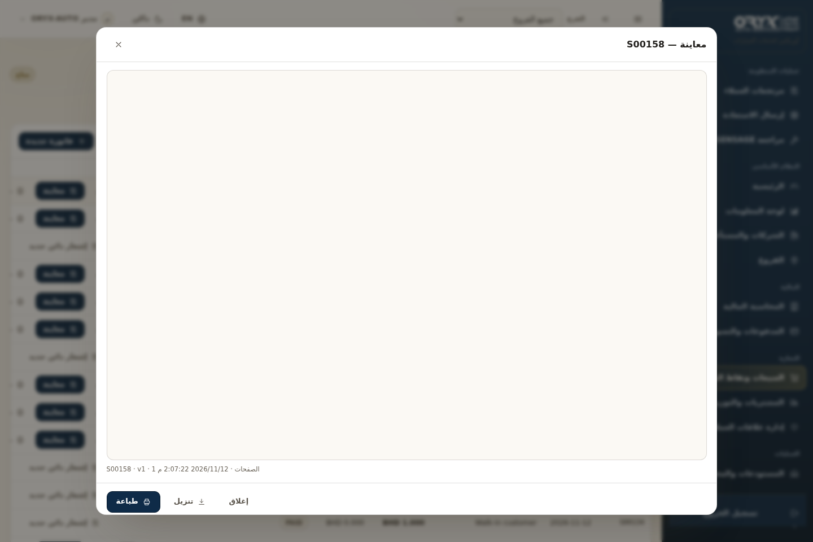
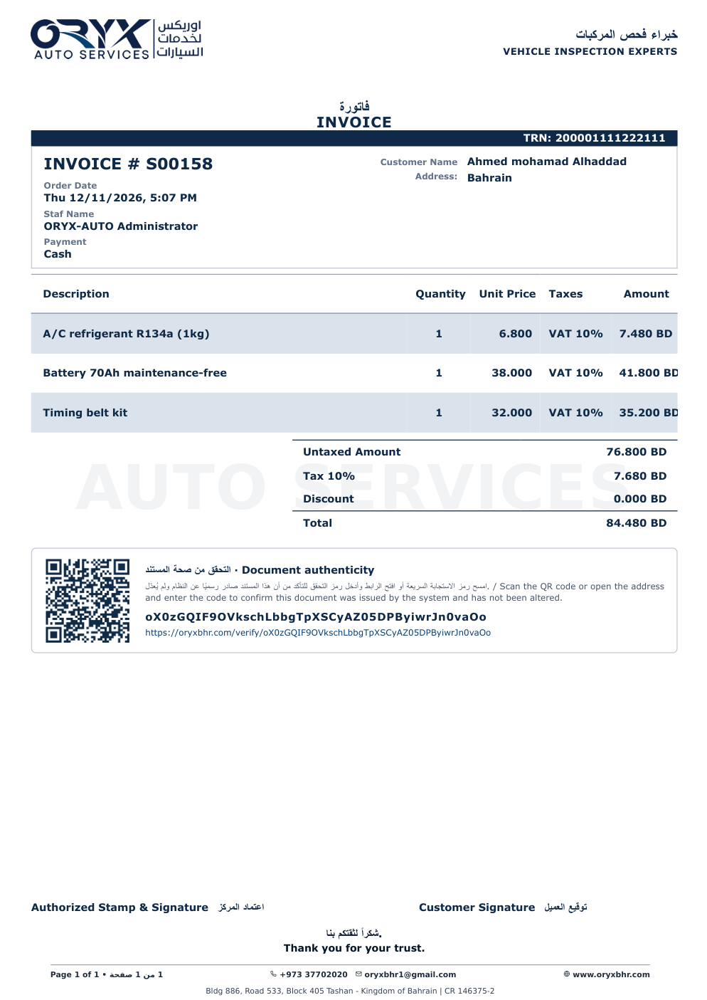

# لقطات الشاشة — فحص السيارات والطباعة وفاتورة المبيعات

> أُنشئت هذه اللقطات بواسطة وكيل ذكاء اصطناعي (OpenHands) نيابةً عن مالك المستودع.
> جميعها من المنصة الحيّة ببيانات حقيقية (مستأجر ORYX Auto، واجهة عربية RTL، الثيم الفاتح).

## 1) فحص السيارات — شاشات الإدخال

**قائمة الفحوصات وزر «فحص جديد»**

**نموذج إنشاء فحص جديد**

**مساحة عمل الفحص (بنود الفحص والمخططات والاعتماد)**

## 2) طباعة تقرير الفحص

**تقرير الفحص — الصفحة 1 (ملف PDF فعلي مُصدر)**

**تقرير الفحص — الصفحة 2**

## 3) فاتورة المبيعات

**صفحة المبيعات وقائمة الفواتير**

**نموذج إنشاء فاتورة مبيعات**

**سجل المستندات الرسمية (من هنا تُفتح المعاينة والطباعة)**

**نافذة معاينة الطباعة بالـ PDF الحقيقي**

**فاتورة المبيعات PDF — ضريبة 10% والمجاميع منفصلة**

